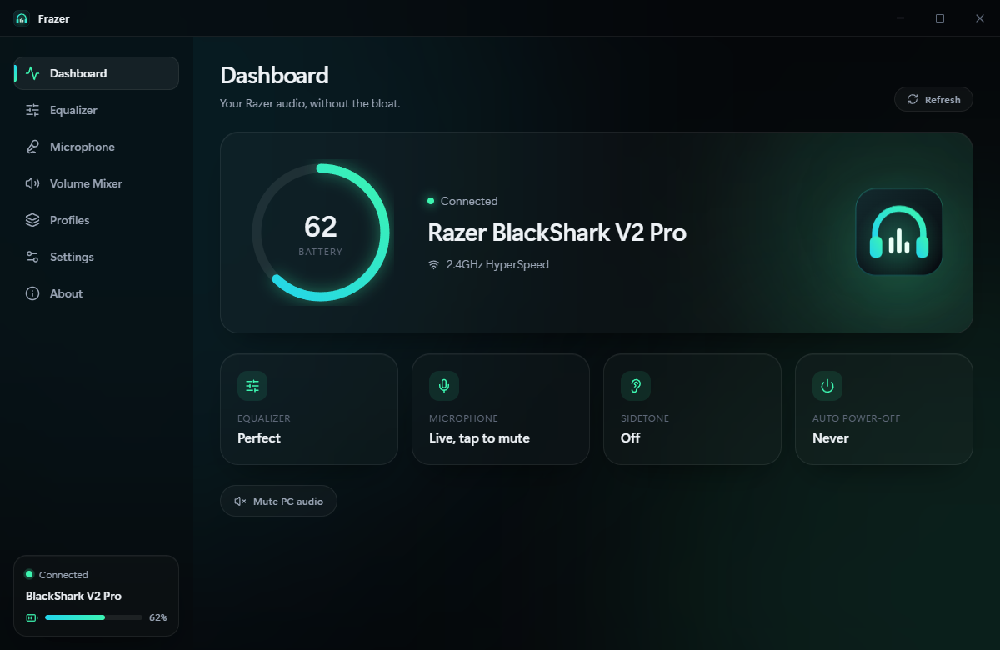
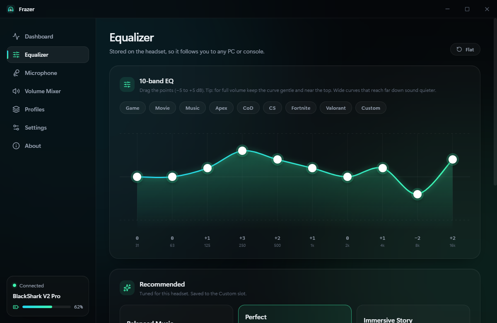
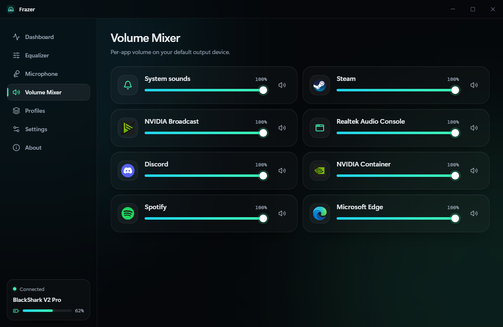
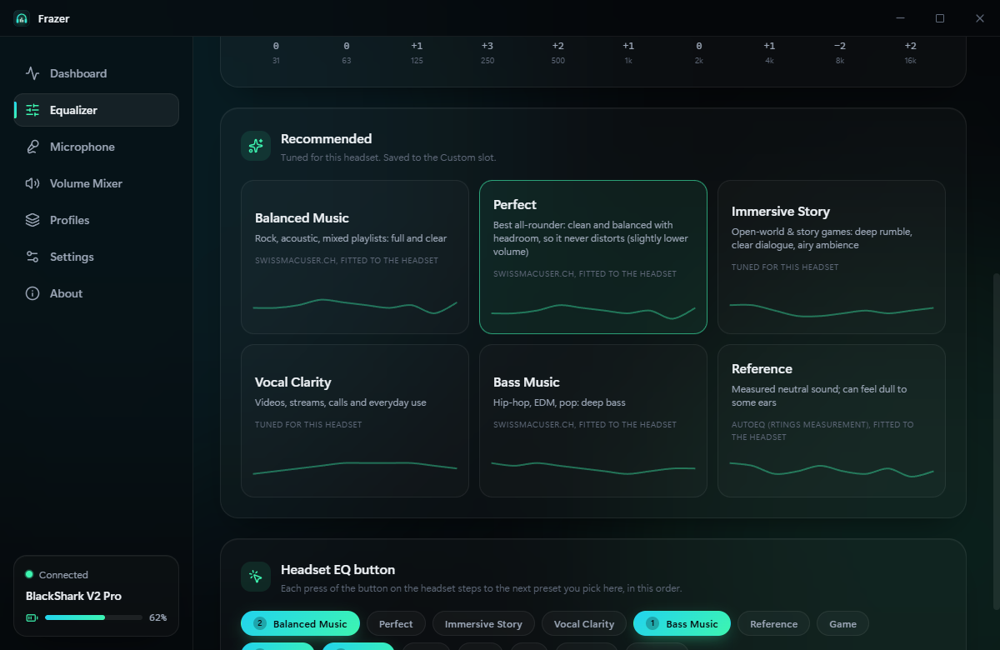
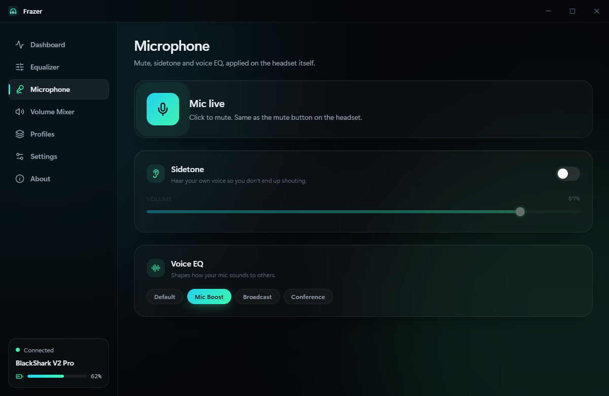
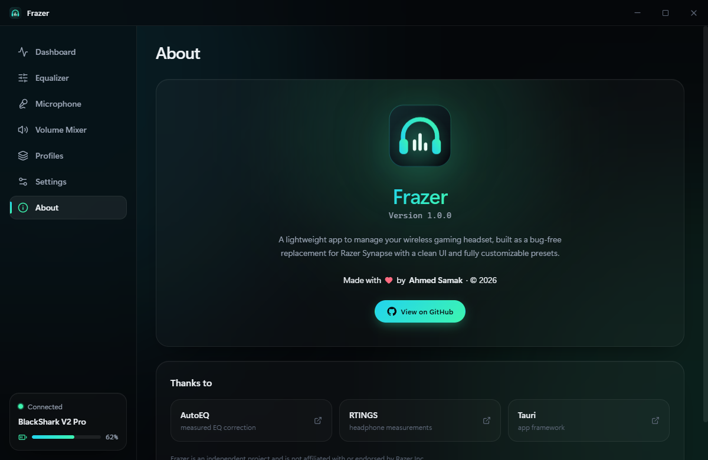

<p align="center">
  
</p>

<h1 align="center">Frazer</h1>

<p align="center">
  <b>Manage your wireless gaming headset, without the bloat.</b><br/>
  A lightweight, bug-free replacement for Razer Synapse with a clean UI and fully customizable EQ presets.
</p>

<p align="center">
  <a href="https://github.com/samak97/Frazer/releases/latest"><b>⬇ Download for Windows</b></a>
</p>

<p align="center">
  
</p>

## Why Frazer?

Razer Synapse is heavy: about a dozen background processes, an account, and settings that sometimes don't apply. On the BlackShark V2 Pro, it also switches the headset's own EQ off while THX is on and fights you over the EQ button.

Frazer talks to the headset **directly over USB**, using the same commands Synapse sends. It's one small app that sits in your tray.

- 🎚️ **On-headset EQ:** a 10-band EQ you drag on a live curve. It's stored on the headset, so it works on any PC or console.
- ✨ **Recommended presets, tuned by ear on the real headset to stay loud and clean:**
  - **Perfect:** the best all-rounder.
  - **Balanced Music** and **Bass Music** for music.
  - **Immersive Story** for open-world and story games.
  - **Vocal Clarity** for videos and calls.
  - **Reference:** a measured correction (AutoEQ, from an RTINGS measurement).
- 🔘 **Your EQ button, your presets:** pick which presets the headset's EQ button cycles through, in your order.
- 🔁 **EQ that sticks:** your EQ is restored and double-checked every time the headset turns on or reconnects.
- 🎙️ **Microphone:** mute, sidetone (hear yourself) and voice EQ presets.
- 🔋 **Live status:** battery, charging and connection, with toasts when something changes.
- 🔊 **Per-app volume mixer:** real app names and icons.
- 🧩 **Profiles:** save a whole setup and switch in one click.
- 🚀 **Starts quietly with Windows** into the tray. Can also stop Synapse's background engine for you.

## Screenshots

| Equalizer |
|---|
|  |

| Volume mixer | Recommended presets & EQ button |
|---|---|
|   |  |

| Microphone | About |
|---|---|
|  |  |


## Supported headsets

| Headset | Battery | EQ (on-device) | EQ button | Sidetone | Mic mute / voice EQ | Auto power-off |
|---|---|---|---|---|---|---|
| Razer BlackShark V2 Pro (2023, `1532:0555`) | ✅ | ✅ | ✅ | ✅ | ✅ | ✅ |
| Razer Barracuda (`053C`, 2024: `0584`) 🧪 | ✅ | 🧪 | — | ✅ | ✅ | ✅ |
| Razer Barracuda Pro (`053A`, 2024: `0583`) 🧪 | ✅ | 🧪 | — | ✅ | ✅ | ✅ |

🧪 The Barracuda models were added from Synapse's own code ([protocol notes](docs/protocol/barracuda.md)) and are still being tested on real hardware. Battery and settings should work; whether the custom EQ is audible is not confirmed yet. The Barracuda has no EQ button.

**Other Razer headsets:** Frazer identifies any Razer headset you plug in, using the product data Razer's own servers publish for Synapse:
- If the headset uses a chip family Frazer already supports, it works right away, without an update.
- Otherwise the dashboard shows the model with a **Request support** button. It opens a GitHub issue with the details already filled in, and adding one chip family usually covers several headsets.

Frazer sends Razer's server only the USB ID of the Razer devices you plug in, once per device, and caches the answer. See [docs/adding-a-device.md](docs/adding-a-device.md) to add a family yourself.

## Install

1. Download the installer from [Releases](https://github.com/samak97/Frazer/releases/latest) and run it.
2. Plug in the HyperSpeed dongle and turn the headset on.
3. If Synapse is installed, Frazer shows a **Close Synapse** button. Its background engine otherwise takes over the EQ button. In **Settings** you can also stop Synapse from starting with Windows; Frazer keeps a copy of its startup entry, so you can switch it back on.

THX Spatial Audio isn't included. It's a Windows audio driver Synapse installs, not a headset setting.

## Build from source

You need [Bun](https://bun.sh), Rust, and WebView2 (included with Windows 11).

```bash
bun install
bun run tauri dev     # run in development
bun run tauri build   # build the installers into src-tauri/target/release/bundle
```

## How it works

```
React UI --(invoke)--> Tauri commands --> HeadsetManager --> HeadsetDriver (per model)
                                               |                  |
                                     event listener        MxicClient (framing) --> hidapi --> dongle
                              (EQ button, power, battery)
```

- **Protocol:** read from Synapse 4's own device code. See [docs/protocol/blackshark-v2-pro.md](docs/protocol/blackshark-v2-pro.md) and [tools/re](tools/re/README.md).
- **Code layout:** `src-tauri/src/hid/` holds the framing, drivers, device registry and event parsing, all with unit tests.
- **Hardware check:** `cd src-tauri && cargo run --bin probe`. It reads battery and settings without changing anything.
- **UI debugging:** start the app with `WEBVIEW2_ADDITIONAL_BROWSER_ARGUMENTS=--remote-debugging-port=9222`, then use `tools/debug/cdp-eval.ts` or `cdp-shot.ts`.

## Credits

- [AutoEQ](https://github.com/jaakkopasanen/AutoEq) and [RTINGS](https://www.rtings.com): the measured correction behind the "Reference" presets.
- [swissmacuser.ch](https://swissmacuser.ch/?p=9690): the community music curves behind "Bass Music" and "Balanced Music".
- Built with [Tauri](https://tauri.app), React and Rust.

Frazer is an independent project and is not affiliated with or endorsed by Razer Inc. "Razer", "BlackShark" and "Synapse" are trademarks of Razer Inc., used here only to describe compatibility.

---

Made by **Ahmed Samak** · © 2026 · [MIT License](LICENSE)
